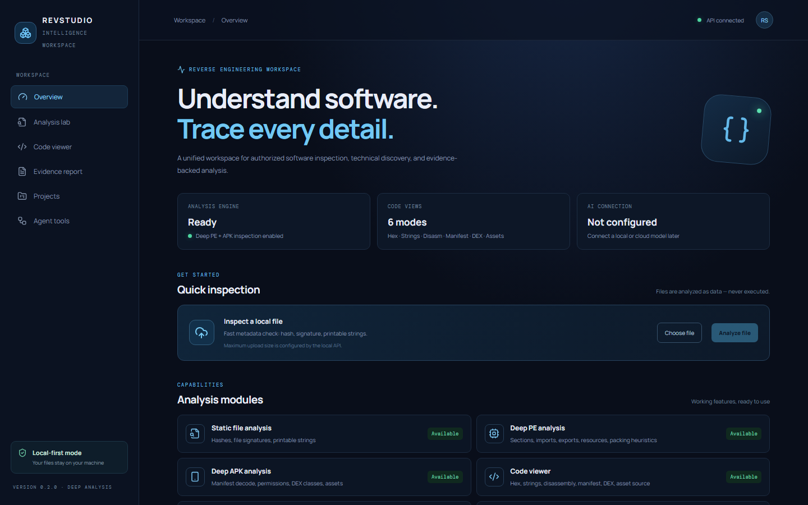
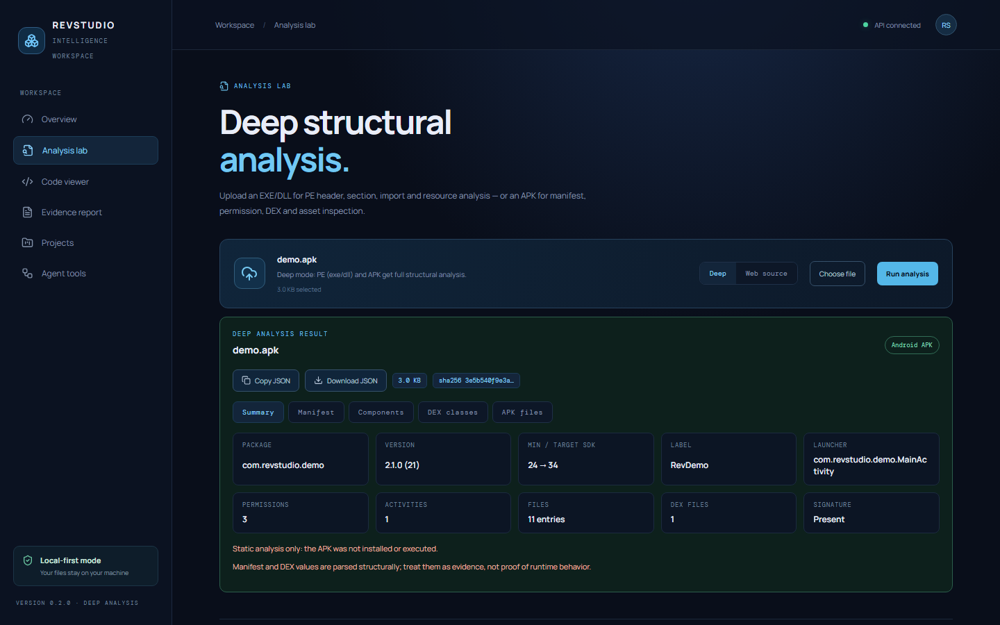
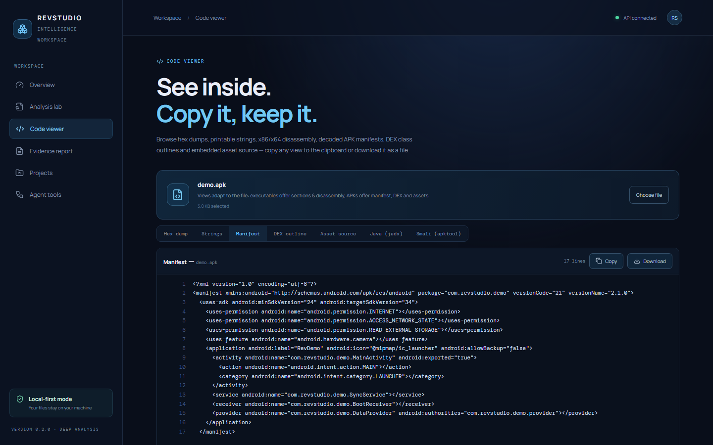
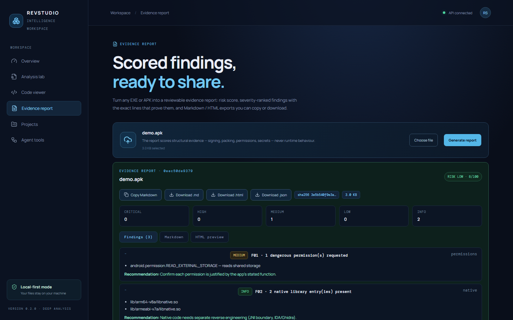
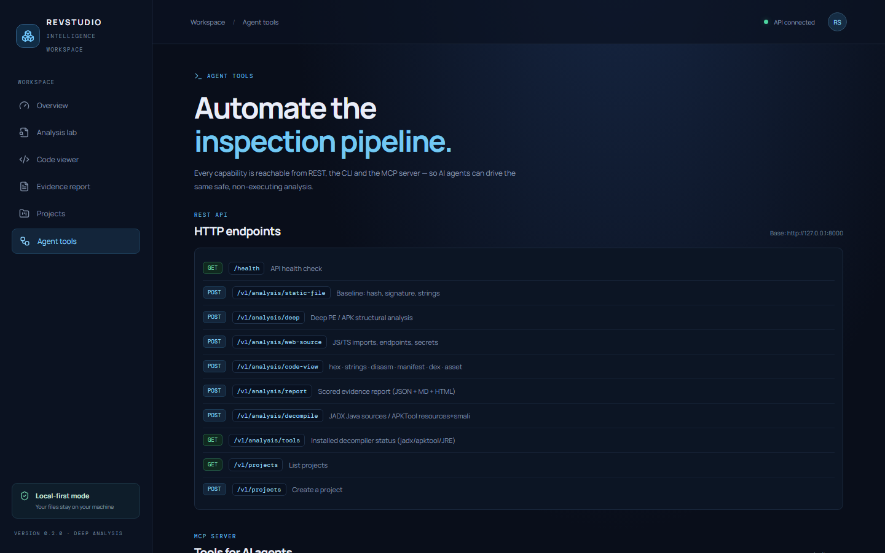

# Reverse Engineering Studio

**Local-first, evidence-based software inspection workspace** — deep EXE/DLL and APK analysis, a code viewer with copy/download, scored evidence reports, and JADX/APKTool decompilation. Files never leave your machine.

**Targets:** Windows · macOS · Linux · Android · iOS · any device with a browser



---

## Table of contents

- [Screenshots](#screenshots)
- [Features](#features)
- [Architecture](#architecture)
- [Quick start (Windows)](#quick-start-windows)
- [Setup on other devices](#setup-on-other-devices)
  - [macOS / Linux laptop](#macos--linux-laptop)
  - [Windows laptop/PC](#windows-laptoppc)
  - [Android phone (Termux)](#android-phone-termux)
  - [iOS / iPad (server on Mac, UI on device)](#ios--ipad)
  - [Using the app from a phone on the same Wi-Fi](#using-the-app-from-a-phone-on-the-same-wi-fi)
  - [Desktop app (Tauri)](#desktop-app-tauri)
  - [Android APK build (Capacitor)](#android-apk-build-capacitor)
- [External tools: JADX, APKTool, JRE](#external-tools-jadx-apktool-jre)
- [API reference](#api-reference)
- [CLI reference](#cli-reference)
- [MCP server (AI agents)](#mcp-server-ai-agents)
- [Tests](#tests)
- [Screenshots regeneration](#screenshots-regeneration)
- [Safety](#safety)

---

## Screenshots

| Analysis lab — deep APK analysis | Code viewer — manifest, Java, smali |
|---|---|
|  |  |

| Evidence report — scored findings | Agent tools — MCP endpoints |
|---|---|
|  |  |

---

## Features

### 1. Deep structural analysis (`Analysis lab`)
- **PE (EXE/DLL):** headers, sections with entropy, imports/exports, resources, version info, .NET detection, Authenticode signature check, overlay detection, TLS/debug/PDB info, **packing heuristics** (UPX/ASPack names, high entropy, entry-point anomalies).
- **APK:** binary **AndroidManifest.xml decode (AXML)**, package/version/SDK levels, permissions, activities/services/receivers/providers, launchable activity, **DEX class outlines** (strings/types/protos/methods/classes), assets, native libs, signature entries, zip inventory.
- **Web source (JS/TS/HTML):** imports, functions, classes, URLs, API endpoints, redacted secret findings.
- Copy or download every result as JSON.

### 2. Code viewer — view, copy, download (`Code viewer`)
| View | Applies to | Content |
|---|---|---|
| Hex dump | any file | offset / hex / ASCII, paging by offset+limit |
| Strings | any file | printable strings ≥ 4 chars |
| Disassembly | PE | x86/x64 via capstone, per section |
| Manifest | APK | fully decoded `AndroidManifest.xml` |
| DEX outline | APK | class/method outline from `classes.dex` |
| Asset source | APK | text/JSON/JS/HTML assets inside the APK |
| **Java (jadx)** | APK | full decompiled Java sources |
| **Smali (apktool)** | APK | decoded resources + smali listing |

Every view has **Copy** and **Download** buttons.

### 3. Evidence reports (`Evidence report`)
- Scored findings (**critical / high / medium / low / info**) with concrete evidence lines and recommendations.
- Rules: suspicious PE imports (injection/anti-debug), RWX sections, packing, unsigned binaries, TLS callbacks, overlays, PDB leaks, dangerous Android permissions, debuggable/allowBackup, hardcoded secrets (AWS keys, tokens, passwords, private keys), and more.
- Risk score 0–100 + level, severity counts, SHA-256 subject identity.
- Export: **Markdown**, **self-contained HTML** (dark, printable), **JSON** — copy or download.

### 4. Decompilation (JADX + APKTool)
- `POST /v1/analysis/decompile` with `tool=jadx` (Java sources) or `tool=apktool` (resources/smali).
- List classes/files, then fetch any single file's content (fuzzy path match).
- Runs as a subprocess with timeout and output caps — analyzed files are **never executed**.

### 5. Agent tools (MCP)
Six MCP tools for AI agents: `inspect_local_file`, `analyze_deep_file`, `view_file_code`, `generate_evidence_report`, `decompile_apk`, `list_capabilities`.

---

## Architecture

```
Reverse-Engineering-Studio/
├── apps/web/                  React + TypeScript dashboard (Vite)
│   └── src-tauri/             Tauri 2 desktop shell
├── apps/mobile/               Capacitor Android wrapper
├── services/api/              FastAPI local API (:8000)
├── services/cli/              revstudio CLI
├── services/mcp-server/       MCP tools for AI agents
├── engines/static-analysis/   Python engine (PE, APK, AXML, DEX,
│                              code views, evidence reports, decompiler)
├── tests/                     46 tests (pytest)
├── scripts/                   demo/sample generators, screenshot capture
├── docs/screenshots/          README screenshots
└── tools/                     jadx, apktool.jar, jre21 (downloaded, git-ignored)
```

---

## Quick start (Windows)

**Requirements:** Windows 10/11, [Python 3.11+](https://python.org), [Node.js 20+](https://nodejs.org), git.

```powershell
# 1. Clone
git clone https://github.com/shahid-boop/Reverse-Engineering-Studio.git
cd Reverse-Engineering-Studio

# 2. Python environment
python -m venv .venv
.venv\Scripts\Activate.ps1
pip install -e ./engines/static-analysis
pip install -e "services/api[dev]"
pip install -e ./services/cli
pip install -e ./services/mcp-server
pip install pefile capstone          # engine dependencies

# 3. Start the API (terminal 1)
uvicorn revstudio_api.main:app --host 127.0.0.1 --port 8000
# → API docs: http://127.0.0.1:8000/docs

# 4. Start the web UI (terminal 2)
npm install
npm run dev
# → Open http://localhost:5173
```

> **Note for managed Windows (Smart App Control / AppLocker):** if `npm run dev` fails on the native rollup binary, run:
> ```powershell
> npm install "rollup@npm:@rollup/wasm-node" --no-save
> ```
> This swaps in the WebAssembly build — same functionality, no native DLL.

**Try it:** in the UI open **Analysis lab → Choose file → `samples/demo.apk` → Run analysis**, or try any EXE (e.g. `C:\Windows\System32\where.exe`).

---

## Setup on other devices

### macOS / Linux laptop

```bash
git clone https://github.com/shahid-boop/Reverse-Engineering-Studio.git
cd Reverse-Engineering-Studio

python3 -m venv .venv
source .venv/bin/activate
pip install -e ./engines/static-analysis
pip install -e "services/api[dev]"
pip install -e ./services/cli
pip install pefile capstone

# Terminal 1 — API
uvicorn revstudio_api.main:app --host 127.0.0.1 --port 8000

# Terminal 2 — Web UI
npm install
npm run dev          # http://localhost:5173
```

Optional desktop shell (Tauri — needs Rust): `npm run desktop:dev`
Optional Android build (Capacitor — needs Android Studio): see [below](#android-apk-build-capacitor).

### Windows laptop/PC

Same as [Quick start (Windows)](#quick-start-windows). Use `cmd` or PowerShell; if `npm` is blocked by execution policy, use `npm.cmd` instead of `npm`.

### Android phone (Termux)

Run the whole stack directly on the phone:

```bash
pkg install python nodejs-lts git
git clone https://github.com/shahid-boop/Reverse-Engineering-Studio.git
cd Reverse-Engineering-Studio

python -m venv .venv
source .venv/bin/activate
pip install -e ./engines/static-analysis
pip install -e "services/api[dev]"
pip install pefile capstone

# API — bind to all interfaces so the phone browser can reach it
uvicorn revstudio_api.main:app --host 0.0.0.0 --port 8000

# In another Termux session (or `&` background):
npm install && npm run dev -- --host 0.0.0.0
```

Then open `http://localhost:5173` in the phone's browser.

> Termux tip: keep the session alive with `termux-wake-lock`. JADX/APKTool additionally need a JDK (`pkg install openjdk-17`) and the `tools/` layout described below.

### iOS / iPad

iOS does not allow running a Python/Node server on-device, so pick one:

1. **Server on your Mac, UI on the iPhone/iPad (easiest)**
   - On the Mac: start the API and web dev server as in the macOS section, but bind the API with `--host 0.0.0.0`.
   - On the Mac: `npm run dev -- --host 0.0.0.0`.
   - On the iPhone/iPad (same Wi-Fi): open `http://<mac-ip>:5173`.
   - Make sure the macOS firewall allows incoming connections for Node.
2. **Native app:** build the Capacitor shell on a Mac (`npm run build && npm run mobile:sync`), then open `ios/App/App.xcworkspace` in Xcode and run on the device.

### Using the app from a phone on the same Wi-Fi

Works for **any** phone/tablet (Android or iOS) with a desktop/laptop running the stack:

```bash
# On the computer — start both servers bound to the LAN:
uvicorn revstudio_api.main:app --host 0.0.0.0 --port 8000
npm run dev -- --host 0.0.0.0
```

Find the computer's IP (`ipconfig` on Windows, `ip addr` on Linux, `ipconfig getifaddr en0` on macOS), then on the phone browser open:

```
http://<computer-ip>:5173
```

The UI shows **API connected** when it reaches the API. If the page loads but the API shows offline, set the API base URL at build time:

```bash
VITE_API_BASE_URL=http://<computer-ip>:8000 npm run dev -- --host 0.0.0.0
```

### Desktop app (Tauri)

```bash
npm install
npm run desktop:dev     # development
npm run desktop:build   # packaged app (installer per OS)
```

Requires the [Tauri prerequisites](https://tauri.app/start/prerequisites/) (Rust toolchain; on Windows also WebView2 + MSVC build tools).

### Android APK build (Capacitor)

```bash
npm install
npm run build           # builds apps/web into dist
npm run mobile:sync     # syncs dist into apps/mobile (Capacitor)
npm run mobile:android  # opens Android Studio
```

In Android Studio: sync Gradle, connect a device/emulator, Run. Configure signing (`Build → Generate Signed Bundle/APK`) before releasing.

---

## External tools: JADX, APKTool, JRE

Decompilation (Java sources, smali/resources) uses external tools placed in `tools/`:

```
tools/
├── jre21/            # portable JRE 21+ (bin/java.exe)
├── jadx/             # jadx zip extracted (bin/jadx.bat, lib/)
└── apktool.jar       # APKTool jar
```

Download (any OS — tools are cross-platform):

| Tool | Download | Put it here |
|---|---|---|
| JRE 21+ | [Adoptium Temurin JRE](https://adoptium.net/temurin/releases/?version=21) (`.zip`/`.tar.gz`) | extract → `tools/jre21/` |
| JADX | [github.com/skylot/jadx/releases](https://github.com/skylot/jadx/releases) (`jadx-x.x.x.zip`) | extract → `tools/jadx/` |
| APKTool | [github.com/iBotPeaches/Apktool/releases](https://github.com/iBotPeaches/Apktool/releases) (`apktool_x.x.x.jar`) | save → `tools/apktool.jar` |

Or set `REVSTUDIO_TOOLS=/path/to/tools` to keep them elsewhere.

**Verify:**

```bash
GET  http://127.0.0.1:8000/v1/analysis/tools   # JSON status
revstudio tools                                 # CLI status
```

If a JRE is already installed system-wide (`java` on PATH), the `tools/jre21/` folder is optional.

---

## API reference

Base URL: `http://127.0.0.1:8000` · Interactive docs: `/docs` · OpenAPI: `/openapi.json`

| Method | Path | Body (multipart) | Returns |
|---|---|---|---|
| GET | `/health` | — | service status |
| POST | `/v1/analysis/deep` | `file` | deep PE/APK analysis |
| POST | `/v1/analysis/code-view` | `file`, `view`, `target?`, `offset?`, `limit?` | hex/strings/disasm/manifest/dex/asset view |
| POST | `/v1/analysis/report` | `file`, `include_markdown?`, `include_html?` | scored evidence report |
| POST | `/v1/analysis/decompile` | `file`, `tool=jadx\|apktool`, `entry?`, `filter?` | Java sources or decoded resources |
| GET | `/v1/analysis/tools` | — | jadx/apktool/JRE availability |
| POST | `/v1/analysis/web-source` | `file` | JS/TS/HTML source analysis |
| GET/POST | `/v1/projects` | `{name}` | project list / create |

Example:

```bash
curl -X POST http://127.0.0.1:8000/v1/analysis/deep -F "file=@samples/where.exe"
curl -X POST http://127.0.0.1:8000/v1/analysis/decompile -F "file=@samples/demo.apk" -F "tool=jadx" -F "entry=MainActivity"
```

---

## CLI reference

```bash
revstudio inspect  <file>                      # metadata, SHA-256, strings
revstudio deep     <file>                      # deep PE/APK analysis (JSON)
revstudio code     <file> --view manifest      # hex|strings|disasm|manifest|dex|asset
revstudio report   <file>                      # evidence report (scored findings)
revstudio report   <file> --out report.html    # write .md or .html
revstudio report   <file> --json               # full JSON
revstudio decompile <file> --tool jadx --entry MainActivity
revstudio decompile <file> --tool apktool --list
revstudio tools                                # external tool status
```

---

## MCP server (AI agents)

```bash
pip install -e ./services/mcp-server
revstudio-mcp
```

Tools: `inspect_local_file`, `analyze_deep_file`, `view_file_code`, `generate_evidence_report`, `decompile_apk`, `list_capabilities`.
Files are read only where you point the agent — they are never executed.

---

## Tests

```bash
pip install -e ./engines/static-analysis
pip install -e "services/api[dev]"
pytest            # 46 passed
```

Coverage includes PE/APK inspectors, AXML/DEX parsers, code views, evidence reports, and the API endpoints.

---

## Screenshots regeneration

```bash
# API + web dev server must be running first
.venv/Scripts/python.exe scripts/make_screenshots.py
```

Uses headless Chrome (CDP) and writes 6 PNGs to `docs/screenshots/`.
Sample files are generated with `scripts/make_demo_apk.py`.

---

## Safety

- Files are inspected **as data and never executed**.
- External tools (jadx/apktool) run on a temp copy with timeouts and output caps.
- Analyze only files you own or are authorized to inspect.
- Dynamic analysis, if added later, must run in a disposable isolated sandbox with explicit consent.
- Never put API keys in frontend source code.

---

**REVSTUDIO © 2026 · LOCAL-FIRST · EVIDENCE-DRIVEN**
